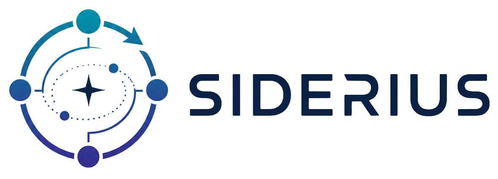

<p align="center">
  <a href="https://siderius.scitra.org/hackathon">
    <picture>
      <source media="(prefers-color-scheme: dark)" srcset="assets/siderius-dark.svg">
      
    </picture>
  </a>
</p>

# The Galileo Hackathon

**Design, Explore, and Discover with SIDERIUS.**

Bring a scientific question and curiosity. Work with your teammates and a coding
agent to test ideas, understand the evidence, and build a reproducible solution.
You do not need to be an experienced machine-learning researcher: start with the
provided baseline, a working reference solution, and improve one thing at a time.
You make the scientific decisions; an agent can help with the implementation.

[Event website](https://siderius.scitra.org/hackathon) ·
[Track 2 team form](https://docs.google.com/forms/d/e/1FAIpQLSev8hGo7nDUhCTdStuvUgp3nDbvrAPjiRnaw-nVD6lAWEfauA/viewform) ·
[Submission portal](https://submit.siderius.scitra.org/track2) ·
[Live leaderboard](https://siderius.scitra.org/hackathon/leaderboard) ·
[Discord help](https://discord.gg/FXfcGTUb)

## Challenge day in six steps

| Step | Do this | You are ready when… |
| --- | --- | --- |
| 1 | [SSH into your assigned GPU](#2-prepare-your-team-and-computer) | H100 is visible and PyTorch can use CUDA. |
| 2 | [Set your OpenAI key](#set-your-openai-api-key) | The presence check succeeds without displaying the key. |
| 3 | [Run the CPU TESS + Luna warm-up](#3-cpu-warm-up-with-tess-and-luna) | You have a baseline result, live analysis and a next experiment. |
| 4 | [Prepare the complete model package](#6-package-and-submit-a-working-model) | Code, seed, initial model and trained model are all present and reproducible. |
| 5 | [Upload the ZIP](https://submit.siderius.scitra.org/track2) by **4:00 pm** | You receive a model submission ID. |
| 6 | [Upload the report PDF](https://submit.siderius.scitra.org/track2/reports) by **4:30 pm** | The current report is linked to your own task/model submission. |

## 1. Know your track and the schedule

| Track | What you do | Status |
| --- | --- | --- |
| **Track 1: design a challenge** | Individuals turn a scientific question into data, an evaluation and a reproducible baseline. | Closed November 18, 2026. The [original guide](docs/track1-guide.md) and tools remain available. |
| **Track 2: solve a challenge** | Teams of 1–3 choose from eight tasks, develop solutions and explain what they learned. | Challenge day: Saturday, November 21, 2026. |

Join online or at **UC San Diego, CSE 1202**, Department Conference Room,
Computer Science and Engineering Building. Hosted by UC San Diego's
Halıcıoğlu Data Science Institute (HDSI). Online joining details come through
the organizers' participant communications.

All times below are **PST (UTC−8), November 21**.

| When | Your next step |
| --- | --- |
| 10:15 am | Event begins; see the website for talks and the panel. |
| By 11:00 am | Submit the Track 2 team form, including public SSH keys, so access can be prepared. |
| 11:45 am–1:00 pm | Warm-up and onboarding: check access and your environment. |
| Noon | Task packages are scheduled for release on the [repository Releases page](https://github.com/yuema137/siderius-hackathon/releases). |
| 1:00–4:00 pm | Competition: run experiments, package and submit. |
| 4:00 pm sharp | Model submissions close. An upload still in progress is refused; upload early. |
| 4:00–4:30 pm | Finish the report using your completed experiments and submitted model. |
| 4:30 pm sharp | Reports due; challenge-day program ends. Live standings remain provisional. |
| Within three days after challenge day | Final results for both tracks, after verification. |

## 2. Prepare your team and computer

Submit one team form and choose a person to coordinate uploads. Keep the team ID
and access code handy. Organizers send GPU-machine access details to teams;
API keys are sent separately. You can also work on your own machine.
Never put an access code, API key, private SSH key or machine address in your
submission, public repository, or public help message.

You need a laptop with a terminal and a browser. For an organizer GPU machine,
your laptop must hold the private key matching the **public** SSH key you sent.
An SSH key is your login credential: only the `.pub` file should be shared.
If you do not already have a key, run this in Terminal or Windows PowerShell
(and do not overwrite an existing key):

```sh
ssh-keygen -t ed25519 -C "your-email@university.edu"
```

Run the SSH command in your access message **on your laptop**. Replace the IP
and key path below with your assigned values; do not type the angle brackets:

```sh
ssh -i ~/.ssh/id_ed25519 team@<assigned-IP>
```

Windows PowerShell also supports `ssh`; use your key's Windows path if needed.
Check the first-connection fingerprint against the access message or with an
organizer before accepting it. `Permission denied (publickey)` usually means
you selected a different private key from the public key on your team form.
Ask an organizer to add the correct **public** key; never send your private key.

Once the prompt is `team@…`, the following commands run **on the GPU machine**:

```sh
nvidia-smi --query-gpu=name,memory.total --format=csv,noheader
source /opt/siderius/.venv/bin/activate
python -c "import torch; print(torch.__version__, torch.cuda.is_available())"
```

The last command should print the installed PyTorch version and `True` on the provided GPU machine.
Use `tmux new -s train` for a long-running job; detach with Ctrl-b then d and
return with `tmux attach -t train` after reconnecting.
The [Track 2 technical guide](docs/track2-guide.md) covers your own machine,
data preparation, submission files and task interfaces. For SIDERIUS itself,
start with [Get started](https://siderius.scitra.org/getting-started) and
[tutorials](https://siderius.scitra.org/tutorials).

### Set your OpenAI API key

Do this in the terminal where you will run SIDERIUS, **after SSH** if using the
team machine. Start a Bash shell first (also works from macOS Terminal):

```sh
bash
read -r -s -p "OpenAI API key: " OPENAI_API_KEY
printf '\n'
export OPENAI_API_KEY
python -c 'import os; print("OPENAI_API_KEY is set" if os.environ.get("OPENAI_API_KEY") else "Key missing")'
```

Paste the separately supplied team key at the hidden prompt. The check prints
only whether a key is present; it does **not** prove the key works. The Luna
warm-up below makes the actual API calls. Repeat this in a new terminal or
tmux session; do not put the literal key in a command, notebook, submission or
Git repository. A key set on your laptop is not automatically forwarded by SSH.
The variable name follows the [official OpenAI SDK documentation](https://developers.openai.com/api/docs/libraries).

## 3. CPU warm-up with TESS and Luna

During warm-up, follow [the TESS exercise](examples/warmup-tess/README.md).
You do not need a GPU for this exercise: inspect a small set of TESS light
curves, run a deterministic CPU baseline, and use Luna to interpret its result
and propose a next experiment. This is practice, not one of the eight scored
tasks, and it does not use a model-submission attempt.

On the prepared team machine, with the environment and key from step 2 set:

```sh
git clone https://github.com/yuema137/siderius-hackathon.git ~/siderius-hackathon
cd ~/siderius-hackathon
uv run --no-project --with numpy --with pyarrow python examples/warmup-tess/preview.py --output-dir /tmp/tess-warmup
/opt/siderius/.venv/bin/python examples/warmup-tess/orchestrate.py --preview-dir /tmp/tess-warmup --output-dir /tmp/tess-warmup-luna --live
```

If you already cloned the repository, enter that checkout instead of cloning
again. Use a new output directory for another live attempt. The preview downloads
about 5 MB of data; dependency installation may take longer on a new laptop.
For your own computer, the exercise README includes the framework installation
and corresponding Python path. While GPU access is not yet released, the CPU
preview can run independently on your laptop.

The exercise separates the **offline CPU preview** from the **live Luna
capability calls**. A preview proves your data and baseline work; only a
successful live run proves your API key and Luna access work. The expected
outputs and exact commands are in the exercise README. Keep the plots, baseline
result and proposed next experiment, and explain the result to your teammate.

This is a deliberately small orchestration exercise using CPU-side reasoning
capabilities. SIDERIUS v1.1.0's full training loop requires CUDA; you will use
the H100 for that during the competition. For the warm-up, follow the bounded
Luna recipe instead of launching a full research run. For substantive
competition experiments, switch to the Moderate profile described below.

## 4. Get a task and run its baseline first

After the noon release, get packages from the
[Releases page](https://github.com/yuema137/siderius-hackathon/releases).
Do not use this repository's Track 1 quickstart examples as competition tasks.
On organizer machines, released task packages and data are provided under
`/data/galileo/<slug>/`; copy the package into your own work folder before editing.
If access or files are not yet available, check announcements or ask an organizer.

| Domain | Scientific problem | Task slug |
| --- | --- | --- |
| Physics | Recover exoplanet orbits from radial-velocity measurements | `exoplanet-orbits` |
| Mechanical & aerospace engineering | Forecast the wake of a pitching airfoil | `pitching-wing-wake` |
| Materials science | Predict metal nanocluster stability | `cluster-magic-numbers` |
| Biology | Infer directed cell–cell signalling | `cell-signalling` |
| Chemistry | Predict catalyst adsorption energies | `catalyst-binding` |
| Medicine | Predict aneurysm wall shear stress | `aneurysm-wall-stress` |
| Earth & climate | Detect and locate geoneutrino events | `geoneutrinos` |
| Scientific computing | Select reliable sparse linear-system solvers | `solver-selection` |

A **slug** is the task's exact identifier: use the same one for your package,
portal choice and report. You may not solve a task that any teammate helped design.

Read its `TASK_CARD.md`, package README and baseline instructions. Identify the
input, output, split, metric direction, and validity checks before changing code.
Prepare the data and run the provided baseline's documented training and
evaluation commands. Keep its output as your first comparison. Commands differ
between tasks; use the released package's recipe, not a guessed universal command.

Data downloads range from roughly 0.2 MB to 20.5 GB. Geoneutrinos is about
20.5 GB and pitching-wing-wake about 3.4 GB; allow time and disk space. Shared
organizer data avoids downloading it again. See the technical guide for commands.

## 5. Experiment and keep evidence as you go

**We recommend orchestration mode for the competition.** A coding agent can
choose and revise the sequence of SIDERIUS capability calls as evidence arrives,
giving it more room to explore. Workflow mode follows a predefined path: it is
cost-effective and predictable, but has less flexibility and a lower exploration
ceiling. Orchestration is a recommendation, not a guarantee of a better score.

Start with **Luna for smoke tests**, then use **Moderate for substantive runs**:

| Purpose | LLM configuration in SIDERIUS v1.1.0 |
| --- | --- |
| Check that setup and a short run work | `configs/llm/openai_smoke_luna.json` |
| Run your actual experiments (recommended) | `configs/llm/openai-moderate-v1.json` |

You may replace the models. API prices differ by model and provider; check prices
and set a budget before running. These profiles select models **inside SIDERIUS
capabilities**. Your external orchestration agent uses its own model and budget.
See [mode and configuration setup](docs/track2-guide.md#choose-a-mode-and-model-profile).

Write an initial hypothesis: what change should help, and why? For each run, save
its ID, code version, settings, reason for the change, result and next decision.
Keep the original logs, including real failures. Change one interpretable thing
at a time where possible; a negative result can still teach you something useful.

**Train only on training data.** Use validation to compare models and choose configurations, not as training
examples or targets to fit. Do not memorize validation answers, use label lookup
tables, or optimize model parameters directly against validation labels.
Do not train on test data. Geoneutrinos uses public-validation scoring as an
explicit exception to hidden scoring; this is **not permission to fit validation
labels**, and its score does not establish hidden-set generalization.

Include complete original training source. Organizers can retrain it and review
whether the submitted artifact is reproducible. A high metric alone is not proof
of scientific validity: inspect outputs and the task's checks, and record limitations.

## 6. Package and submit a working model

One ZIP represents one task. **All five items are required:**

| Include | What judges need |
| --- | --- |
| Complete training code | Data preparation, model construction, training loop, configuration and exact command. |
| Complete inference code | A self-contained plugin implementing the task's interface. |
| Random seed | The actual `seed` (integer 0–4,294,967,295) in `submission.json`, applied by your code to every random generator it uses; record other deterministic settings. |
| Initial model | Save the state immediately after initialization, before training: `initial_weights: "initial.pt"`. |
| Final trained model | Save the final state: `weights: "weights.pt"`. Include it even for tasks whose score uses fresh retraining. |

Put `submission.json` at the ZIP root and complete training source in `train/`.
Your `train_command` must reproduce the model using only the train split.
Initial weights are audit evidence; reproduction initializes afresh from the
seed, rather than trusting an uploaded checkpoint. For an algorithm with no
learned weights, include its initial and final implementation/configuration
using `kind: "algorithm"` and `initial_artifact`, as explained in the guide;
do not create dummy weight files.
Use the [packaging example and task contracts](docs/track2-guide.md#package-and-check)
to avoid spending an attempt on a broken path or wrong output shape.

Sign in to the [Track 2 portal](https://submit.siderius.scitra.org/track2) with
your team ID and access code, choose the matching task, and upload. Save the
submission ID and artifact checksum with your experiment records.

- **Ten accepted uploads TOTAL per team across all tasks**, shared across whichever tasks you choose.
  Accepted uploads count even if evaluation later fails. Uploads refused by the
  portal's initial format check do not count.
- Leave **at least three minutes** between uploads to the same task.
- Scoring and review take time. `queued` → `running` → `reviewing` is not yet a
  leaderboard result. Only `scored`, after review passes, appears on the board.
  `held` needs organizer review; `failed` or `rejected` is not a valid score.
- Your **best valid scored submission on each task** counts. Different tasks
  have different metrics: never compare or average their raw scores across tasks.
- Upload early and confirm the portal accepts your ZIP before 4:00 pm.
  A timely accepted submission can remain queued and be evaluated after the deadline.

## 7. Explain what you learned in a report

Prepare **one report per task**, identifying your team, task slug and the exact
final model submission ID. Use the standard LaTeX source in
[templates/track2-report](templates/track2-report/), its
[instructions](templates/track2-report/README.txt), or the
[PDF preview](templates/track2-report/preview.pdf). Compile with
`latexmk -pdf main.tex` (or run `pdflatex main.tex` twice).

The body is **at most four pages**, including title, abstract, figures, tables,
AI-use statement and optional reward-hacking discussion. References may take
extra pages; no narrative appendices. There is no minimum length or hard word
count. Preserve the template's font sizes, margins and spacing.

Cover six sections: scientific goal and initial hypothesis; research trajectory;
final model and comparisons; up to three key insights with evidence and
limitations; limitations and next experiment; reproducibility, contributions and
AI use. Compare the official baseline, final model and a meaningful alternative.
Logs are supporting evidence, not a way to move your core argument outside the limit.

Your team writes the research judgments, insights, limitations and loophole
explanations. AI may help organize logs, translate and proofread; it must not
generate the core arguments. AI coding assistance is allowed: disclose its use
and explain verification. We do not use AI detectors to judge authorship.

**Reports are due November 21, 2026, at 4:30 pm PST (UTC−8).** Use the final
30 minutes to organize evidence and finish the report for the model submitted
by 4:00 pm; this does not extend model uploads or permit new competition scores.
Use the [**separate report PDF upload**](https://submit.siderius.scitra.org/track2/reports)
in the same Track 2 portal (PDF up to **10 MiB**): select the
task and link the report to your own submission ID for that task. Updating a
report does not consume any of your ten model uploads. Only the current report
version is used; replacements close at 4:30 pm. Linking a failed submission to discuss a negative result does
not make it a valid scored model.

## 8. Awards and help

Models and reports are considered together. Track 2 awards are **Outstanding
Scientific Solution ×2**, **Outstanding Research & Insight ×1**, and **Reward
Hacking Discovery ×1**. Evidence, reproducibility and scientific meaning matter
alongside improvement over the relevant baseline. A well-supported negative
result can earn the Research & Insight award. For a reward-hacking discovery,
show the reproducible gap between a high score and scientific failure and propose
a fix, including its potential false positives.

Track 1 awards are **Outstanding Scientific Task ×1** and **Outstanding Evaluation
Design ×1**. One award per individual or team across both tracks; each participant
may receive at most one gift card. Live standings are provisional until verification.

Ask on [Discord](https://discord.gg/FXfcGTUb) or speak to an organizer on site.
Include your task slug, the command, error message and what you already tried.
Share credentials and private access problems directly with organizers, never in
public channels. If you are stuck, ask early; do not use an upload as a substitute
for a local packaging check.

## Repository map and licenses

| Path | Use |
| --- | --- |
| [docs/track1-guide.md](docs/track1-guide.md) | Preserved Track 1 participant guide (closed). |
| [docs/track2-guide.md](docs/track2-guide.md) | Track 2 setup, data and submission reference. |
| [templates/track2-report/](templates/track2-report/) | Standard LaTeX report source and PDF preview. |
| [AGENTS.md](AGENTS.md), [SPEC.md](SPEC.md) | Existing Track 1 agent workflow and exact package rules. |
| [examples/warmup-tess/](examples/warmup-tess/) | Track 2 CPU + Luna practice exercise; not a scored task. |
| Other [examples/](examples/), [tools/](tools/), [skills/](skills/) | Existing Track 1 walkthroughs and checking tools; not Track 2 packages. |

The kit is [MIT licensed](LICENSE). The report template preserves the official
NeurIPS 2026 formatting and its [CC BY 4.0 attribution](templates/track2-report/LICENSE-ATTRIBUTION.txt).
Its use does not imply NeurIPS or ML4PS submission, acceptance or endorsement.
