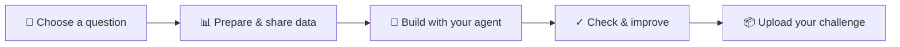

# Create a scientific challenge

**The Galileo Hackathon · Track 1**

Bring a scientific question that you want others to explore with machine learning.
Your challenge gives them **data, a clear goal, a fair evaluation, and a working
baseline**. A baseline is a simple solution that others can reproduce and improve.

**You do not need to write code by hand.** Work with a coding agent such as
Claude Code or Codex. You make the scientific decisions; your agent helps turn
them into a runnable SIDERIUS task package.

[Explore ideas & datasets](https://siderius.scitra.org/hackathon/track-1#data) ·
[Register for Track 1](https://docs.google.com/forms/d/e/1FAIpQLSegtIj5T3vizkBu_Vy66cXYVrgAEU0pYpEJzxIrPJxY74n5mQ/viewform) ·
[Open submission portal](https://submit.siderius.scitra.org)



## Start with the science

A good challenge is more than “get a higher score.” Decide:

- **What would we learn?** Name the scientific question and why its answer matters.
- **What can the data tell us?** Define one independent sample and make sure there
  is enough data and scientific information to support the question.
- **What counts as success?** Choose a meaningful measurement and a fair test on
  unseen samples. Keep related patients, experiments, or simulation runs together.

For example, a detector-signal challenge might ask: *Can we remove noise without
erasing a weak physical signal?* A useful evaluation would check signal recovery
as well as noise reduction, with different acquisition runs held out for testing.
This is an idea to develop—not an announced competition task.

## 1 · Design it with your agent

Open your coding agent and paste this. Replace the brackets with what you know;
it is fine to start with an incomplete idea.

```text
Help me design a scientific ML challenge for The Galileo Hackathon.
Use this kit: https://github.com/yuema137/siderius-hackathon
Read README.md, AGENTS.md, and SPEC.md first.

My scientific question: [what I want to understand]
My data: [a link, local files, or a simulation I could use]
My available compute and time: [what I can use]

First help me decide the inputs, outputs, independent samples,
train/test split, evaluation, and a simple baseline. Ask about missing
information and explain the choices in plain language before coding.

Once I confirm the design, help set up the supported SIDERIUS version,
prepare the task package and challenge brief, and run the baseline.
Ask before large downloads or training. Tell me which files to upload
to Zenodo and what information you need back from me.
```

Your agent can use the [worked example](examples/quickstart_classification/)
to understand the format. Its tiny synthetic dataset demonstrates packaging;
it is not the target scale for a scientific challenge. The example's Zenodo
record is currently a placeholder, so it is not yet a fully downloadable submission.

## 2 · Handle the human steps

| You do | Your agent helps with |
| --- | --- |
| **Register for Track 1** to receive submission access; sign in with GitHub. | Prepare your submission locally while access is arranged. |
| **Confirm the science and data-sharing rights.** Check permission before redistributing someone else's dataset. | Inspect data, propose a split and evaluation, and identify possible shortcuts. |
| **Upload and publish the data on [Zenodo](https://zenodo.org).** Choose an appropriate license, then give your agent the record link/DOI. Restricted records must be shared with organizers as described in the kit. | Prepare the data files, record their checksums, and build the download/processing script. |
| **Approve compute use and review the results.** Make sure the challenge represents your intent. | Run the baseline, explain the results, and save the files needed to reproduce them. |
| **Upload the final zip to the [submission portal](https://submit.siderius.scitra.org).** Choose whether to permit public release. | Build the zip and give you its checksum to compare with the upload receipt. |

## 3 · Ask your agent to check it

There are two distinct parts:

| Check | What it does |
| --- | --- |
| **Deterministic checker** | Checks files, data access and checksums, SIDERIUS loading, and reproduction of reported baseline scores. It makes **no LLM calls**. |
| **LLM-assisted skill** | Guides your agent through running the checker, explaining failures, fixing problems, and offering advisory feedback about evaluation and leakage. It cannot override the checker result. |

After building your package, paste:

```text
My submission is at [folder path]. My Zenodo record is [link].
Use skills/track1-task-check/SKILL.md in the hackathon kit.

Run the deterministic checker, explain any failures, and help me fix
and recheck them. Ask before downloading data or retraining the baseline.
Report PASS, FAIL, or INCOMPLETE exactly; do not treat skipped required
checks as a pass or change reported scores just to make checks pass.

Give advisory feedback separately. When the submission is ready,
use tools/make_submission.py to build the zip. Tell me its location,
checksum, and anything I still need to do before uploading.
```

Organizer review is a **manual reproducibility check**, not a judgment of
scientific merit or research quality. “Verified” only confirms reproducibility
of the reviewed version. Your agent's advice does not grant that status.

## What goes in the submission?

| Component | Purpose |
| --- | --- |
| 📝 **Challenge brief** | Explain the question, evaluation, baseline, and known limitations. |
| 🔗 **Data access** | Link to Zenodo and provide code to fetch, verify, and prepare the data. |
| 📦 **Task package** | Tell SIDERIUS how to read inputs, produce outputs, and score results. |
| ▶️ **Working baseline** | Provide the runnable solution, saved model, and reported results. |

Upload **one zip**. The dataset stays on Zenodo. Other participants cannot see
your submission; public release requires your permission. You can upload a new
version until the deadline; the latest is reviewed.

**Technical instructions for your agent:** [AGENTS.md](AGENTS.md) ·
[Exact specification](SPEC.md) ·
[Check skill](skills/track1-task-check/SKILL.md) ·
[Challenge brief template](templates/TASK_CARD.md)

License: [MIT](LICENSE).
